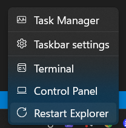

# Taskbar Context Menu Custom Items

A [Windhawk](https://windhawk.net/) mod for Windows 11 that adds your own items
to the taskbar right-click menu. Out of the box that menu only offers "Taskbar
settings" and "Task Manager". With this mod it can also start programs, open
folders, run scripts, and jump to URLs or settings pages.

The items are added to the native menu itself, so they look and behave like the
built-in ones.

Mod file: [`taskbar-context-menu-custom-items.wh.cpp`](taskbar-context-menu-custom-items.wh.cpp)

## Install

1. Open Windhawk and click **Create a New Mod**.
2. Replace the editor contents with the mod file from this repository.
3. Click **Compile Mod**, then **Exit Editing Mode**.
4. Right-click an empty part of the taskbar.

The first time, and again after Windows updates that change the taskbar,
Windhawk downloads debug symbols before the mod can take effect. This can take
a couple of minutes, and the custom items only appear once it is done.

## Menu items

Each item in the mod settings has:

| Field | Meaning |
| --- | --- |
| Label | Text shown in the menu. A single dash (`-`) adds a separator line. |
| Command | Anything the Run dialog (Win+R) accepts: a program, a file or script, a folder, a URL, an `ms-settings:` page or a `shell:` location. Environment variables are expanded. |
| Arguments | Optional command-line arguments. |
| Icon | Optional hex code of a [Segoe Fluent Icons](https://learn.microsoft.com/en-us/windows/apps/design/style/segoe-fluent-icons-font) glyph such as `E756`, or a single character such as an emoji. |
| Run as administrator | Starts the command elevated, with the usual UAC prompt. |
| Hide window | Starts the command without a visible window. Useful for scripts and console commands. |

An item with a label but no command is shown greyed out, which can be used as a
heading.

### Examples

| Label | Command | Arguments |
| --- | --- | --- |
| Terminal | `wt.exe` | |
| Downloads | `shell:Downloads` | |
| Display settings | `ms-settings:display` | |
| Network connections | `ncpa.cpl` | |
| My script | `powershell.exe` | `-NoProfile -File "C:\Scripts\my script.ps1"` |
| Restart Explorer | `cmd.exe` | `/c taskkill /f /im explorer.exe & start explorer.exe` |

## Other settings

| Setting | Default | Meaning |
| --- | --- | --- |
| Placement | bottom | Custom items above or below the built-in items |
| Separator line | on | Line between the custom items and the built-in items |
| Submenu name | empty | If set, the custom items are grouped in a submenu with this name |

Settings take effect the next time the menu is opened.

## Notes

* Windows 11 only. The mod extends the modern taskbar menu and has no effect on
  the Windows 10 taskbar or on taskbar replacements.
* Only the menu of the taskbar itself is changed, not the menus of app buttons,
  the Start button or the system tray.
* Commands run with the same permissions as File Explorer, unless "Run as
  administrator" is turned on.
* Enable Windhawk logging for the mod to see whether the taskbar hooks were
  installed and which commands were started.

## Credits

The menu injection technique is based on
[Taskbar Restart Explorer](https://windhawk.net/mods/taskbar-restart-explorer)
by Mgrmjp and
[Windows 11 Taskbar Auto-Hide in Context](https://windhawk.net/mods/taskbar-autohide-in-context)
by oyrslyng.

## License

[MIT](LICENSE)
